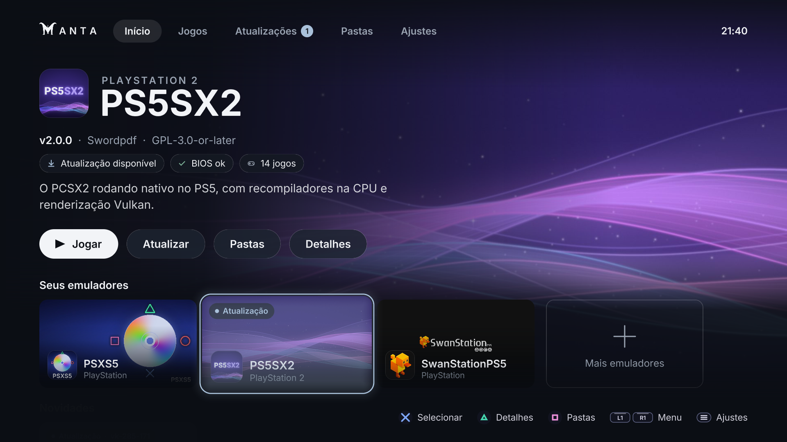
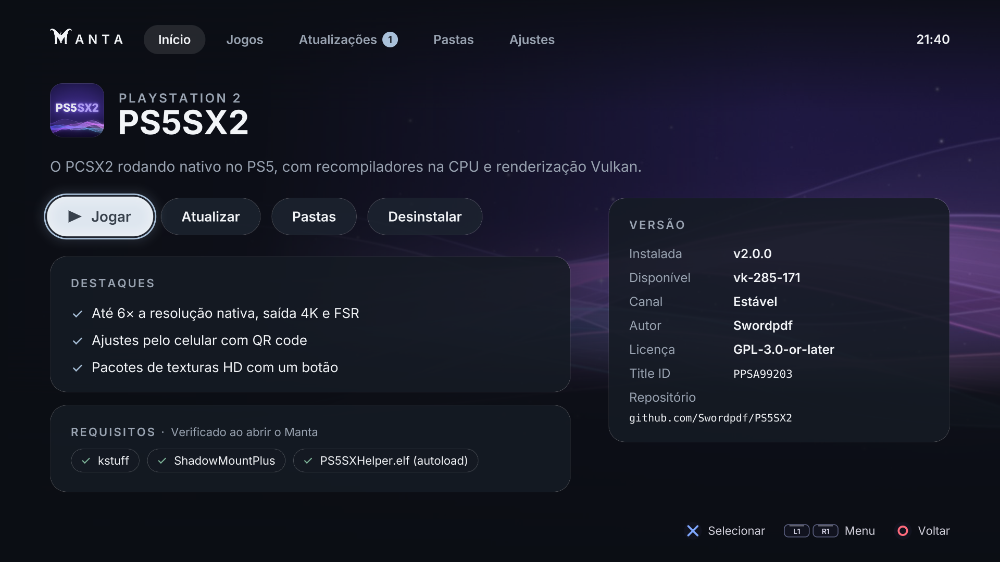
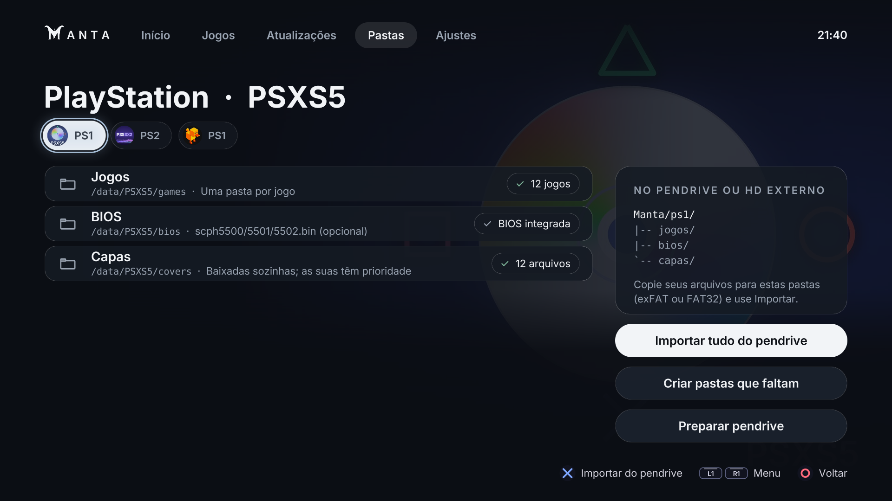
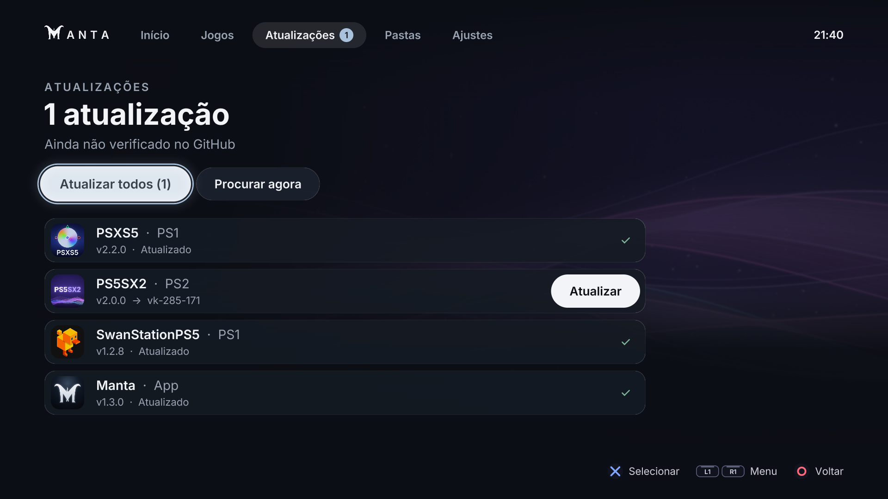
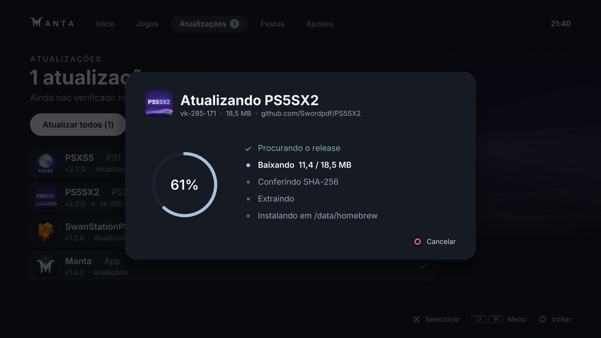

<p align="center">
  
</p>

<h1 align="center">Manta</h1>

<p align="center">
  <a href="README.md">English</a> · <a href="README.pt-BR.md">Português</a> · <b>Español</b>
</p>

<p align="center">
  <b>Todos los emuladores de tu PS5 en un solo lugar.</b><br>
  Instala, actualiza, organiza y juega — sin FTP, sin PC, sin complicaciones.
</p>

<p align="center">
  <a href="../../releases/latest"></a>
  
  <a href="LICENSE"></a>
</p>

<p align="center">
  
</p>

> **Idioma de la app:** por ahora Manta está en inglés y portugués, y sigue el idioma de la
> consola. Con la consola en español, la app aparece en inglés. En esta guía, los nombres de
> botones y pestañas están en inglés, tal como los verás en pantalla.

---

## Por qué existe Manta

Cada emulador nativo de PS5 vive en un repositorio distinto, con su propia forma de instalarse,
sus propias carpetas y su propio ritmo de actualizaciones. Para usar tres emuladores había que
descargar tres ZIP en el PC, copiarlos por FTP, ajustar permisos, recordar dónde va cada BIOS y
volver a GitHub de vez en cuando para ver si había una versión nueva.

Manta reúne todo eso en **una sola app, en la propia consola**:

- instalas Manta una vez;
- desde ella, instalas y actualizas cada emulador con un botón;
- copias juegos y BIOS desde un pendrive sin saber ninguna ruta;
- y abres tus juegos desde una biblioteca única, con portadas, como en la pantalla de la PS5.

## Funciones

| | |
|---|---|
| **Catálogo de emuladores** | 8 emuladores nativos de PS5, agrupados por fabricante, con el icono, el arte, el autor, la licencia y los requisitos de cada uno. |
| **Instalar y actualizar** | Descarga la versión más reciente directamente de GitHub, comprueba el **SHA-256** publicado, la extrae y la coloca en su sitio. La versión anterior se guarda hasta que la nueva está lista. "Update all" de una vez. |
| **Desinstalar** | Quita solo la app ("Keep my files") o todo, incluidos juegos, BIOS y partidas guardadas ("Delete everything"). El icono desaparece de la pantalla de inicio solo cuando Manta se cierra. |
| **Biblioteca de juegos** | Todos los juegos de todos los emuladores instalados en una cuadrícula de portadas, con filtro por sistema. Los discos de un mismo juego aparecen una sola vez. |
| **Portadas automáticas** | Usa las portadas que ya tienes y, si quieres, descarga las que faltan de [libretro-thumbnails](https://github.com/libretro-thumbnails/libretro-thumbnails). |
| **Jugar directamente** | En los emuladores que lo admiten (SwanStationPS5, PS5CEMU-HAR), ✕ abre el juego directamente, sin pasar por el menú del emulador. |
| **"¿Abrir en qué emulador?"** | Si más de un emulador instalado ejecuta el juego (p. ej., PSXS5 y SwanStationPS5 para PS1), Manta pregunta cuál usar y recuerda tu última elección. |
| **Carpetas** | Muestra cada carpeta de cada emulador (juegos, BIOS, trucos, partidas…), cuántos archivos tiene y qué falta. Crea las que no existen. |
| **Importar del pendrive** | Copia desde `Manta/<sistema>/<carpeta>/` en el pendrive o disco externo al lugar correcto de la consola. Solo copia: no se borra nada, y lo que ya está se omite. |
| **Preparar pendrive** | Crea en el pendrive el árbol de carpetas de los emuladores instalados, con un `README.txt` que explica qué va en cada una. |
| **Se actualiza solo** | Una versión nueva de Manta aparece en Updates, igual que las de los emuladores. La descarga, la comprueba y hace el cambio en cuanto cierras la app. |
| **Catálogo en línea** | Los emuladores nuevos llegan a Manta sin necesidad de una versión nueva de la app: el catálogo viene del [`catalog/online.json`](catalog/online.json) de este repositorio. |
| **Idiomas** | Inglés y portugués, según el idioma de la consola (o elígelo en Settings). |
| **Hecho para la TV** | Interfaz al estilo de las plataformas de streaming, 60 fps, 4K, sonidos y movimientos suaves, opción para reducir el movimiento, contraste AA. |

### Emuladores del catálogo

| Emulador | Sistema | Autor | Instalación desde Manta |
|---|---|---|---|
| [PSXS5](https://github.com/SynoPiia/PSXS5) | PlayStation | SynoPiia | ✅ |
| [SwanStationPS5](https://github.com/darkxex/SwanStationPS5) | PlayStation | AngelXex | ✅ (abre el juego directamente) |
| [PS5SX2](https://github.com/Swordpdf/PS5SX2) | PlayStation 2 | Swordpdf | ✅ |
| [RPCS3 PS5](https://github.com/lavavex/rpcs3-PS5) | PlayStation 3 | lavavex | ⚠️ solo código fuente; se reconoce si se instala a mano |
| [ProsperoEden](https://github.com/blackbearreloaded/ProsperoEden) | Nintendo Switch | blackbearreloaded | ✅ |
| [PS5CEMU-HAR](https://github.com/premohq/PS5CEMU-HAR) | Wii U · 3DS · DS | premohq | ✅ (abre el juego directamente) |
| [XPSemu](https://github.com/ZiZc3/XPSemu) | Xbox | AZiZ | ✅ |
| [RetroArch PS5](https://github.com/mihawk-99/PS5_RetroArch) | N64, GameCube/Wii, PSP, SNES, GBA, Mega Drive, arcade… | Mihawk | ✅ |

Manta **no incluye** ningún emulador, BIOS ni juego: descarga los emuladores de los repositorios
oficiales de cada autor. Las BIOS y los juegos son tuyos.

## Capturas

<p align="center">
  
  
  
  
  
  
</p>

## Requisitos

- **PS5 con jailbreak** y un HEN que dé acceso a `/data` (etaHEN, LegacyJB u OnionHEN, con
  **kstuff**).
- **[ShadowMountPlus](https://github.com/drakmor/ShadowMountPlus)**, que pone en la pantalla de
  inicio las apps de `/data/homebrew/` (Manta y los emuladores que instala).
- **Servidor FTP** en la consola (el de etaHEN o ftpsrv, puerto 2121), solo para instalar Manta la
  primera vez.
- **Internet en la PS5** para instalar y actualizar emuladores y descargar portadas.
- Opcional: **ELF loader** en el puerto 9021 (viene con etaHEN y LegacyJB), que se usa para quitar
  de la pantalla de inicio el icono de un emulador desinstalado.

Probado en: firmware 13.60, LegacyJB + kstuff + ShadowMountPlus.

## Instalación

En la página de [**Releases**](../../releases/latest) hay dos formas de instalar. Elige una.

### Opción 1 — instalador `.elf` (recomendado, sin FTP)

1. Descarga **`Manta-vX.Y.Z-installer.elf`**.
2. Envía el archivo al **ELF loader** de la PS5 (puerto **9021**), igual que cualquier otro
   payload:
   - desde el PC: `python scripts/send-elf.py <IP-de-la-PS5> Manta-vX.Y.Z-installer.elf`
     o una app como NetCat GUI;
   - o desde el menú de payloads de tu HEN, si carga archivos `.elf` desde un pendrive.
3. La PS5 muestra un aviso de que Manta se instaló. Al momento, **Manta** aparece en la pantalla
   de inicio.

El instalador lleva la app dentro, así que no necesita internet. Si Manta está abierta, espera a
que la cierres.

### Opción 2 — ZIP por FTP

1. Descarga **`Manta-vX.Y.Z-PPSA98265.zip`** y extráelo. Obtendrás una carpeta llamada
   **`PPSA98265`**.
2. Con el FTP activo, copia **la carpeta completa** a `/data/homebrew/` en la consola, de modo que
   quede `/data/homebrew/PPSA98265/eboot.bin`, `.../sce_sys/`, `.../assets/`.
   - **Cliente FTP** (FileZilla, WinSCP…): conéctate a `IP-de-la-PS5`, puerto `2121`, usuario
     anónimo, sube la carpeta y dale permiso `777` a ella y a todo su contenido.
   - **Script** (Python 3): `python scripts/deploy-ps5.py <IP-de-la-PS5> --folder ruta/a/PPSA98265`
     sube todo con los permisos correctos.
3. Espera unos segundos: ShadowMountPlus registra la app y **Manta** aparece en la pantalla de
   inicio.

> La IP de la PS5 está en **Ajustes › Red › Estado de la conexión**. Para comprobar una descarga,
> el `SHA256SUMS.txt` de la versión trae el hash de cada archivo
> (`certutil -hashfile <archivo> SHA256` en Windows, `sha256sum` en Linux/macOS).

La primera vez, Manta le pide acceso a `/data` al HEN y busca las versiones más recientes de los
emuladores.

### Actualizar Manta

**Desde la propia Manta:** cuando sale una versión nueva, aparece en **Updates** (fila "Manta").
Pulsa **Update**. Manta descarga y comprueba la versión nueva y luego te pide que cierres la app.
En cuanto la cierras, se hace el cambio y la PS5 muestra un aviso. Solo tienes que volver a
abrirla. Esto usa el ELF loader (puerto 9021).

**Sin ELF loader:** envía el instalador `.elf` nuevo o copia el ZIP nuevo encima de la carpeta.
Tus emuladores, juegos y ajustes no se tocan.

### Desinstalar Manta

Borra `/data/homebrew/PPSA98265` (y, si quieres, `/data/emuland`, donde están la caché de
portadas y los ajustes). Los emuladores instalados siguen funcionando.

## Cómo se usa

### Controles

| Botón | Acción |
|---|---|
| ✕ | Confirmar · Jugar · Instalar |
| ○ | Volver |
| □ | En Games: abrir las carpetas (Folders) del emulador del juego |
| L1 / R1 | Cambiar de pestaña |
| OPTIONS | Ajustes (Settings) |

### Paso a paso

1. **Instala un emulador** — En **Home**, elige el emulador y pulsa ✕ para ver los detalles. Pulsa
   **Install**. Manta lo descarga, lo comprueba y lo instala. Al terminar, **cierra Manta** cuando
   te lo pida: ShadowMountPlus solo registra apps nuevas con Manta cerrada. Vuelve a abrir Manta.
2. **Prepara un pendrive** (exFAT o FAT32) — En **Folders**, pulsa **Prepare USB drive**. Manta
   crea `Manta/<sistema>/jogos`, `Manta/<sistema>/bios`, etc., y un `README.txt`.
3. **Copia tus archivos en el PC** — Los juegos y las BIOS van en las carpetas correctas del
   pendrive. Los nombres de las carpetas son iguales en todos los idiomas (`jogos` = juegos).
   Ejemplo:

   ```
   Manta/
   ├── ps1/
   │   ├── jogos/   Crash Bandicoot (USA).chd
   │   └── bios/    scph5501.bin
   └── ps2/
       ├── jogos/   Shadow of the Colossus (USA).iso
       └── bios/    (tu BIOS de PS2)
   ```

4. **Importa** — Conecta el pendrive a la PS5. En **Folders**, elige el emulador y pulsa
   **Import all from USB** (o ✕ en una carpeta para importar solo esa).
5. **Juega** — En **Games**, elige el juego y pulsa ✕. Si más de un emulador lo ejecuta, Manta
   pregunta cuál usar.
6. **Mantén todo al día** — La pestaña **Updates** muestra lo que tiene versión nueva. **Update
   all** lo resuelve de una vez. Manta busca actualizaciones al abrirse (como máximo cada 6 horas,
   para respetar el límite de GitHub).

### Dónde guarda cada emulador sus archivos

| Emulador | Carpeta en la consola | Carpeta en el pendrive |
|---|---|---|
| PSXS5 | `/data/PSXS5` (`games`, `bios`, `covers`) | `Manta/ps1/` |
| SwanStationPS5 | `/data/SwanStationPS5` (`games`, `bios`, `covers`) | `Manta/ps1-swan/` |
| PS5SX2 | `/data/PCSX2` (`games`, `bios`, `cheats`, `patches`, `textures`, `memcards`) | `Manta/ps2/` |
| RPCS3 | `/data/rpcs3` (`games`) | `Manta/ps3/` |
| ProsperoEden | `/data/prosperoeden` (`roms`, `keys`, `firmware`, `updates`, `mods`) | `Manta/switch/` |
| PS5CEMU-HAR | `/data/ps5cemu` | `Manta/wiiu/` |
| XPSemu | `/data/xemu` | `Manta/xbox/` |
| RetroArch | dentro de la app: `content`, `system`, `savefiles` | `Manta/retroarch/` |

La pantalla **Folders** siempre muestra la ruta exacta y lo que falta.

## Preguntas frecuentes

**El emulador dice "BIOS not found", pero el juego abre.** SwanStationPS5 trae una BIOS libre
(OpenBIOS) integrada que ejecuta la mayoría de los juegos. Una BIOS original mejora la
compatibilidad: pon `scph5501.bin` (EE. UU.), `scph5502.bin` (Europa) o `scph5500.bin` (Japón) en
la carpeta `bios`.

**Instalé un emulador y no aparece en la pantalla de inicio.** Cierra Manta: ShadowMountPlus solo
registra apps nuevas cuando no hay ningún juego ni app abiertos.

**"GitHub limit: try again after HH:MM".** Sin cuenta, GitHub acepta 60 consultas por hora por IP.
Manta guarda la última respuesta y te avisa a qué hora puedes volver a intentarlo.

**¿Manta borra algo sin que se lo pida?** No. Importar solo copia, actualizar guarda la versión
anterior hasta que la nueva está en su sitio, y desinstalar pregunta si quieres conservar tus
archivos.

**¿Dónde está el registro (log)?** En `/data/emuland/hub.log` (el de la ejecución anterior en
`hub.prev.log`). El instalador `.elf` escribe en `manta-installer.log`, y el cambio de versión y
las desinstalaciones en `manta-helper.log`, todos en la misma carpeta. Adjúntalo al abrir una
issue.

**Quiero sugerir un emulador para el catálogo.** Abre una issue o un pull request sobre
[`catalog/online.json`](catalog/online.json) ([formato](catalog/README.md)). Una vez aceptado,
aparece para todos sin necesidad de una versión nueva de Manta.

## Seguridad

- Descargas solo por **HTTPS**, solo de los repositorios oficiales del catálogo, comprobadas con el
  **SHA-256** que GitHub publica para cada archivo.
- El ZIP se inspecciona antes de extraerlo: nada fuera de la carpeta de la app, sin rutas con
  `..`, sin enlaces simbólicos, con límites de tamaño y de memoria.
- Manta solo borra la carpeta de una app después de confirmar que de verdad es de esa app.
- Las imágenes (portadas) con dimensiones absurdas se rechazan antes de decodificarlas.
- El catálogo en línea pasa por una validación estricta: un emulador solo puede usar una carpeta
  de datos propia en `/data/<nombre>`, y un documento que incumpla cualquier regla se ignora por
  completo.
- El cambio de versión de la propia Manta solo acepta la carpeta que Manta preparó y solo escribe
  en la carpeta de Manta. Si algo falla a mitad, vuelve la versión anterior.

¿Encontraste una vulnerabilidad? Abre una issue (o, si es delicada, contacta con el mantenedor a
través de su perfil antes de divulgarla).

## Compilar desde el código

Necesitas **Windows con WSL (Ubuntu)** o Linux, con `clang-18`, `lld-18`, `ninja-build`, `rsync`,
`python3`, `make` y `zip`.

```bash
# Windows
scripts\build-ps5.cmd                              # genera hub/dist/PPSA98265 y hub/dist/PPSA98265.zip
python scripts/deploy-ps5.py <IP-de-la-PS5>        # envía el build por FTP
python scripts/deploy-ps5.py <IP-de-la-PS5> --log  # trae /data/emuland/hub.log a logs/

# Linux / WSL
bash scripts/build-ps5.sh
```

El build también genera `hub/dist/manta-installer.elf` (el instalador de un paso, con el ZIP
dentro).

**Publicar una versión:** cambia `MANTA_VERSION` en `hub/src/emuland/model.hpp` y
`contentVersion` en `hub/sce_sys/param.json` (una prueba comprueba que coincidan), escribe la
entrada del `CHANGELOG.md` (y, si quieres, `docs/RELEASE-vX.Y.Z.md`), haz el commit y sube la
etiqueta:

```bash
git tag v1.4.0 && git push origin main v1.4.0
```

GitHub Actions ([`release.yml`](.github/workflows/release.yml)) compila, ejecuta las pruebas y
publica la versión con el ZIP, el instalador `.elf` y el `SHA256SUMS.txt`. Las copias de Manta ya
instaladas ven la versión nueva en Updates.

La primera vez, el build descarga el SDK de payloads de PS5, ps5-opengl y libcurl (PacBrew).

**Vista previa en el PC** (sin consola): `wsl -- bash scripts/hub-preview.sh <carpeta>` genera
todas las pantallas en PNG. **Pruebas:** dentro de `hub/`, `make test-unit` y
`bash tools/installer-test.sh`.

### Estructura

```
hub/        la app (C++20, OpenGL 4.6 con el kit ps5-homebrew-ui)
  src/concepts/emuland.cpp      todas las pantallas
  src/emuland/                  catálogo, biblioteca de juegos, arte
  src/platform/ps5/             instalador, portadas, lanzador, acceso a /data
  host/                         versión de PC para vista previa y pruebas
helper/     payloads: manta_helper (cambio de versión, iconos de apps desinstaladas) y el instalador .elf
catalog/    online.json (catálogo en línea) y emuladores.json (copia del integrado)
.github/    build y publicación automáticos de cada versión
scripts/    build, envío por FTP y vista previa
docs/       diseño (fuente de verdad de la interfaz), plan, identidad visual
```

## Créditos

- Interfaz construida sobre [ps5-homebrew-ui](https://github.com/blackbearreloaded/ps5-homebrew-ui)
  y [ps5-native-app-boilerplate](https://github.com/blackbearreloaded/ps5-native-app-boilerplate),
  de BlackBearReloaded, con el [PS5 Payload SDK](https://github.com/ps5-payload-dev/sdk).
- Portadas de [libretro-thumbnails](https://github.com/libretro-thumbnails/libretro-thumbnails).
- Fuente [Inter](https://github.com/rsms/inter); imágenes con [stb](https://github.com/nothings/stb);
  ZIP con [miniz](https://github.com/richgel999/miniz); red con libcurl + OpenSSL.
- Todos los autores de los emuladores del catálogo, sin los cuales Manta no tendría nada que
  reunir.

Avisos completos en [hub/THIRD_PARTY_NOTICES.md](hub/THIRD_PARTY_NOTICES.md).

## Licencia

[GPL-3.0-or-later](LICENSE). PlayStation y PS5 son marcas de Sony Interactive Entertainment; este
proyecto no tiene relación con Sony. Usa solo juegos y BIOS que poseas.
